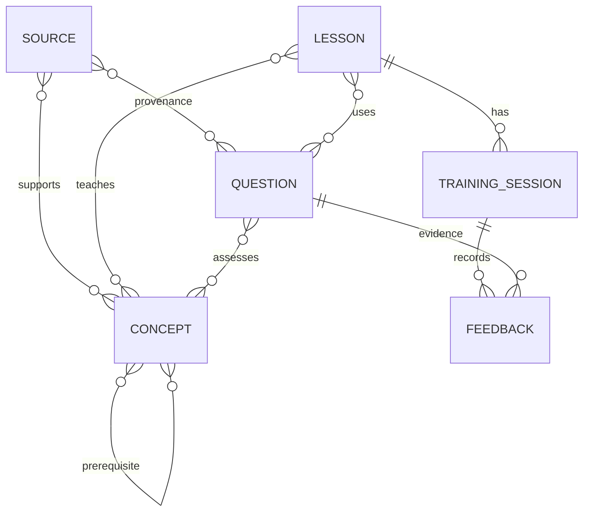

# 课程数据规范（设计草案）

本规范用于后续文件化试点，不是已实现的数据结构。实体采用稳定 ID + 不可变版本；既有 C01—C14、ST-C01-01 等保持原 ID，课次保留 W01D1—W12D5，禁止为同一 ID 复用不同语义。引用采用 `id@version`；修正文案、答案、提示、引用或难度均生成新版本，旧版保留且不可覆盖已记录历史。状态 `draft → reviewed → approved → retired`，重新修改回 draft 并重新审核。时间统一 ISO 8601 带时区，散列用于检测内容变化而非保证事实正确。

## 关系

多对多关联需记录顺序、用途和目标字段；先修边方向是“本概念依赖的概念”，需有 `required` 或 `exposure_only`，后者不能误作正式掌握门槛。诊断对尚未掌握概念可采样但不解锁正式教学或赋予 mastered。

| 实体 | 必填字段（除公共字段外） | 约束 |
|---|---|---|
| Source | `id`（如 R01 或 SRC-LOCAL-001）、`title`、`kind`、`uri_or_path`、`creator`、`accessed_at`、`license`、`permitted_use`、`evidence_type`、`claim_locator` | 来源事实、原创声明及研究证据区分；许可未知则禁止复制、发布。主张引用可列页码/标题/段落。 |
| Concept | `id`、`title`、`thesis`、`mental_model`、`objective`、`prerequisites[]`、`sources[]`、`misconceptions[]`、`mastery_evidence`、`teaching_page` | 先修与来源指向具体版本、存在且无环；Teaching Concept 应符合锁定上游版本模板。 |
| Lesson | `id`、`week`、`day`、`objectives[]`、`abilities[]`、`concept_refs[]`、`question_refs[]`、`sequence`、`duration_target`、`exit_criteria` | 明确任务用途 diagnosis/practice/transfer/review；量化目标及保留 NA。 |
| Question | `id`、`concept_refs[]`、`source_refs[]`、`age_range`、`abilities[]`、`level`、`type`、`child_stem`、`adult_answer_or_rubric`、`reasoning`、`hints`、`parallel_example_ref`、`variant_refs[]`、`equivalence_group`、`validation` | H1/H2 不给出当题最终答案；H3 平行例题须独立审批。公开题卡与成人评分文件分离；题目审批不能由模型自行授予。 |
| Training Session | `id`（如 TS-随机标识）、`learner_pseudonym`、`lesson_ref`、`status`、`started_at`、`updated_at`、`concept_versions[]`、`question_versions[]`、`checkpoint`、`gate_reads[]` | 以每个孩子独立路径存放；`active/paused/completed`；中断后保留轮次、提示、未完成题及恢复点，不覆盖前次。 |
| Feedback | `id`（如 FB-随机标识）、`session_id`、`question_ref`、`event_time`、`response_summary`、`correctness`、`explanation_quality`、`hint_level`、`score`、`observation`、`learner_self_report`、`next_action`、`reviewer` | 原始作答与评价分开；正确性可为 correct/partial/incorrect/NA，解释可为 valid/invalid/unclear/NA；评分 0—3 或 NA，不把停止视为 0。 |

公共字段：`id`, `version`, `created_at`, `updated_at`, `status`, `content_hash`, `reviewer`, `reviewed_at`, `review_notes`；draft 时审核字段可为空，approved 必须人工签名及时间，批准版本和散列匹配。变更记录含旧/新版本、原因及操作者；废止不删除既有历史引用。

## 控制规则

- 难度 L1/L2/L3 是试点人工估计，不是标准化分数；记录阅读负荷、步骤数、抽象度、是否需已有知识及实测体验。诊断从低负荷开始；每次只调整一个维度并记录依据。
- 最近 3 次同类机会至少 2 次评分 ≥2、主要 H0—H1，且至少一次 H0 独立陌生迁移成功，才可标建议升级；H2/H3 后的正确不能当成独立迁移。是否升级由成人审阅；未达标继续/降低难度，不要求强行补足次数。H0—H3 与 0—3 分别存储。
- `Feedback` 为追加事件，同一题允许多轮，每轮记录问答/提示，最终评价引用这些事件；撤销或更正新增更正事件，保留原始历史。训练结束与中断均提交检查点。
- 家长控制按化名保存的最小必要记录；不收集真实姓名、学校、地址、照片、音频原件。记录删除需覆盖会话、摘要、备份及外部同步副本；这是一项待设计和验证的能力，当前文件系统/模型服务不自动提供隐私隔离。
- 成人答案不能出现在儿童视图、日志回显或提示文本中；文件分离并不自动形成访问控制，需要人工流程和测试共同保证。
